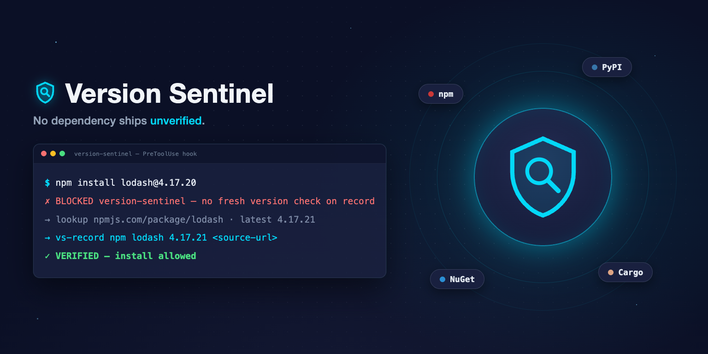

<p align="center">
  
</p>

<p align="center">
  <a href="https://github.com/KSEGIT/Version-Sentinel/releases/latest"></a>
  <a href="./LICENSE"></a>
  
  
</p>

<p align="center"><a href="https://ksegit.github.io/Version-Sentinel/">Website and installation guide</a></p>

<p align="center">Claude Code plugin that warns about missing or stale dependency version checks. Hooks never block tools.</p>

> If an agent changes a dependency without a fresh registry check, Version Sentinel warns and allows the tool call. Upstream verification and `/vs-record` remain recommended.

**Keywords:** Claude Code, Anthropic, AI coding guardrails, LLM supply-chain security, dependency management, hallucinated package versions, npm, PyPI, Cargo, NuGet, PreToolUse hook.

## Why

LLM-assisted coding silently ships whatever version the model remembers from its training data. For packages with frequent releases or known compromised versions, that's unacceptable. `version-sentinel` recommends checking the registry and records the source without stopping your work.

## What it helps you check

- **Hallucinated versions** — LLM picks a version that never existed or never shipped.
- **Stale defaults** — model reaches for a 2-year-old pin because training data froze there.
- **Compromised-release installs** — no guard against yanked / malicious versions without a fresh registry lookup.
- **Silent downgrades** — Claude "fixes" a CI error by reverting a package to an older vulnerable build.
- **Supply-chain drift** — no audit trail of *why* a specific version was chosen.

## How it compares

| Tool | Scope | Result |
|------|-------|-------------|
| `version-sentinel` | Agent hooks — checks before supported edits and installs | Advisory, exit 0 |
| Generic dependency-audit skills | Post-hoc scan of `package.json` / `requirements.txt` | Advisory |
| Dependabot / Renovate | Scheduled PR bot against remote registries | Async PR |

Version Sentinel runs inside the agent workflow. It supplies evidence warnings and registry checks; it does not guarantee that a dependency is safe.

## Supported ecosystems (v0.1)

| File | Ecosystem | Registry |
|------|-----------|----------|
| `package.json` | npm/pnpm/yarn/bun | registry.npmjs.org |
| `requirements*.txt`, `constraints*.txt` | pip | pypi.org |
| `pyproject.toml` | PEP 621 + Poetry + uv | pypi.org |
| `Cargo.toml` | Rust | crates.io |
| `*.csproj`, `*.fsproj`, `*.vbproj` | .NET | api.nuget.org |

Covers `Edit`, `Write`, `MultiEdit`, and `Bash` install commands (`npm install`, `pip install`, `poetry add`, `uv add`, `cargo add`, `dotnet add package`). A registry package without a version, or with a floating tag such as npm `latest`, can produce a warning but remains allowed. Local paths, URLs, git sources, and workspace dependencies are not registry checks and are ignored.

NuGet Central Package Management can supply a version from an ancestor `Directory.Packages.props`. For this reason, a `PackageReference` without a `Version` is not treated as unpinned. Floating NuGet versions such as `Version="*"` can produce advisory warnings.

## Install

```
/plugin marketplace add https://github.com/KSEGIT/Version-Sentinel.git
/plugin install version-sentinel@version-sentinel-marketplace
```

> The `owner/repo` shorthand (`KSEGIT/Version-Sentinel`) resolves to an SSH clone URL and requires GitHub SSH keys. Use the full HTTPS URL above to clone anonymously.

## Multi-agent support

One repo, six agent platforms. The same hook scripts and sidecar state back every integration; each platform gets its own thin adapter (manifest, hook wiring, commands).

| Platform | Install / enable |
|----------|------------------|
| Claude Code | `/plugin marketplace add https://github.com/KSEGIT/Version-Sentinel.git` → `/plugin install version-sentinel@version-sentinel-marketplace` |
| z.ai (GLM Coding Plan / ZCode) | Uses the Claude Code plugin format — same install as Claude Code above (ZCode embeds the Claude Code runtime; GLM Coding Plan runs inside Claude Code) |
| Kimi Code | `/plugins install https://github.com/KSEGIT/Version-Sentinel` (or a local path) |
| GitHub Copilot in VS Code | Files under `.github/` + `.agents/skills/` — works when this repo is the workspace, or copy them into yours |
| Gemini CLI | `gemini extensions install https://github.com/KSEGIT/Version-Sentinel`, then `bash ~/.gemini/extensions/version-sentinel/platforms/gemini/setup.sh` to activate hooks (see `docs/e2e-checklist.md`) |
| OpenAI Codex | `codex plugin marketplace add KSEGIT/Version-Sentinel` → `codex plugin add version-sentinel` (or legacy `.claude-plugin` marketplace compat) |
| Zed | Manual: `AGENTS.md` + `.agents/skills/` + `docs/zed.md` — advisory instructions and manual checks |

Platform-specific layout:

```
plugin.json, .claude-plugin/   Claude Code plugin + marketplace metadata
kimi.plugin.json, platforms/kimi/  Kimi Code plugin manifest + adapter
gemini-extension.json, GEMINI.md   Gemini CLI extension manifest + context
platforms/gemini/setup.sh        Gemini hook activation (run inside the installed extension)
commands/*.toml                Gemini CLI slash commands
.codex-plugin/                 OpenAI Codex plugin metadata
.github/hooks|agents|prompts/  GitHub Copilot hooks, agents, prompts
.agents/skills/                Cross-tool skills (Copilot, Zed, ...)
AGENTS.md                      Cross-tool agent instructions
```

For marketplace listings and submission status per platform (what's ready, what needs an owner-submitted form), see `docs/marketplaces.md`.

## Prerequisites

- `bash`, `jq`, `curl`, `python3` (3.11+, for `tomllib`) on `PATH`
- Windows: Git Bash bundles `bash`/`jq`/`curl`; install Python 3.13 separately.

## How it works

SessionStart suggests `/vs-refresh` and makes no registry requests. Tool hooks warn once per unchanged project state and diagnostic. Changes to dependency files, evidence, settings, or findings can trigger another warning. All hooks return status 0. Continue authorized work and report any limits. [Advisory workflow](docs/enforcement.md)

1. An agent tries to change a dependency or run an install.
2. The hook reports missing or stale evidence as a warning and allows the call.
3. The agent can verify the intended version on its upstream registry and use `/vs-record` to save evidence.
4. If verification fails, report that result truthfully and continue the user's authorized task. Preserve valid manifests and overrides when the parser cannot understand them.

Direct audit and recorder commands can return nonzero for validation failures or CI. These results are advisory.

## Commands

- `/vs-refresh` runs an online project audit and the configured security checks. It reports when saved project audit evidence expires.
- `/check-versions` runs the same audit with the standard report.
- `/vs-record <ecosystem> <pkg> <version> <source>` records an online check for one package.

| Host | How to invoke refresh |
|------|-----------------------|
| Claude Code, Kimi Code | `/version-sentinel:vs-refresh`. Use the same prefix for `check-versions` and `vs-record`. |
| Gemini CLI, GitHub Copilot in VS Code | `/vs-refresh` |
| Codex | Select the `vs-refresh` skill from the `$` picker. The plugin skill is tagged `$version-sentinel:vs-refresh`. |
| GitHub Copilot CLI, Zed | Use the `vs-refresh` skill. Select the matching entry when the host shows a qualified name. |

The three named skills ship in `skills/` and are mirrored in `.agents/skills/` for workspace discovery. In a terminal, run `bash <version-sentinel-root>/scripts/vs-refresh.sh` from the project directory.

## Older pins and offline failures

| Case | How |
|------|-----|
| Deliberate old-version pin | `/vs-record npm pkg 1.0.0 "intentional: CVE fix deferred"` |
| Throwaway session | `export VS_DISABLE=1` |
| Private registry | Not supported by the canonical upstream verifier |
| Registry offline | Report the lookup failure and continue authorized work |

## Sidecar file

State: `<project-root>/.version-sentinel/checks.json` and `audit.json`. Auto-gitignored on first write. The recorder fetches canonical upstream metadata and checks version existence before recording; old pins require an explicit reason too. Post-install hooks do not create verification evidence.

## Uninstall

```
/plugin uninstall version-sentinel@version-sentinel-marketplace
/plugin marketplace remove version-sentinel-marketplace
```

## FAQ

**Does this work with Claude Desktop or just Claude Code?**
Claude Code only — relies on the PreToolUse hook API exposed by the CLI.

**Does it slow Claude down?**
Startup only shows an optional audit reminder. Explicit audits and package recording contact upstream registries. Fresh checks can be reused for the same project/package/version during the configured freshness window; file changes can produce a new audit warning.

**Can I use this for private / internal registries?**
The current verifier supports the public canonical registries only. Report that limitation and continue authorized work; do not claim public verification.

**Why not just run `npm audit` / `pip-audit`?**
Those tools scan vulnerabilities. Version Sentinel recommends version-freshness checks and records sources. Its hooks warn and always allow tools.

**Does it support Go modules, Gradle, Maven, composer, gems?**
Not in v0.1. See `docs/roadmap.md`.

## Related

- [Anthropic Claude Code](https://claude.com/claude-code)
- [Claude Code plugin docs](https://code.claude.com/docs/en/plugin-dependencies)

## License

MIT — see [LICENSE](./LICENSE).

## npm security diagnostics

Explicit audits use npm audit and OSV by default for public npm lockfile v2/v3 projects. Each provider can be disabled separately with the `security_npm_audit` or `security_osv` plugin setting, or `VS_SECURITY_NPM_AUDIT=0` or `VS_SECURITY_OSV=0`. Findings retain provider attribution, severity, advisory IDs, and links. Missing, stale, or incomplete evidence is reported truthfully.

Public tool hooks only check local cached security evidence. They make no provider requests and do not launch the saved-settings CLI. A proposed change can produce a warning even when the resolved tree has current evidence. Use `/vs-refresh` after dependency changes to audit the resolved tree with the configured security checks. Low and moderate findings remain visible as advisory text.

The explicit `reconcile-npm-lock.sh` helper can regenerate a lockfile without install scripts and scan it before replacement. Its Git/project/settings evidence and validation errors apply to that explicit command, not permission to continue other work. See [the privacy policy](https://github.com/KSEGIT/Version-Sentinel/blob/main/PRIVACY.md) for upstream package-name disclosures and local evidence storage.
